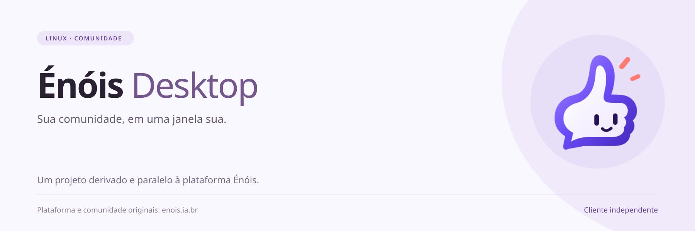
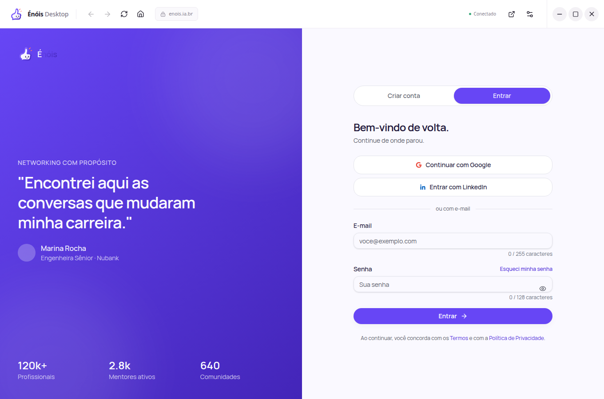
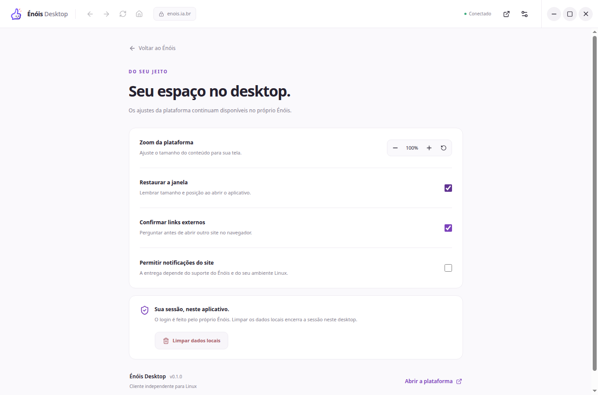
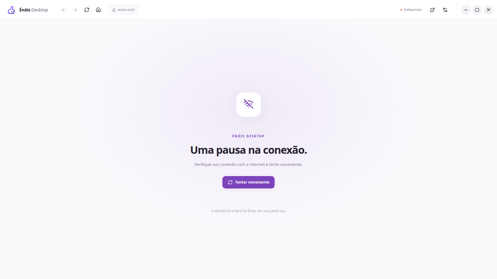
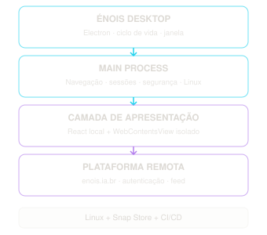

# Énóis Desktop

[](https://github.com/LeandroDukievicz/enois-desktop/actions/workflows/ci.yml)
[](LICENSE)


[](docs/store-publication.md)

Projeto **derivado e paralelo** ao [Énóis](https://enois.ia.br/feed), desenvolvido
de forma **independente** como cliente desktop para Linux.
O próprio site roda em um `WebContentsView` isolado: feed, componentes, estilos,
tema e regras de negócio continuam sendo entregues pela plataforma original.
O código local acrescenta navegação, ciclo de vida, sessão persistente e recuperação
de erros. Não há afiliação oficial confirmada.

**Créditos ao projeto original Énóis, a seus criadores, mantenedores e à sua
comunidade**, que constroem a plataforma e sua identidade visual. Esta adaptação
desktop é mantida por [Leandro Dukievicz](https://github.com/LeandroDukievicz).
Veja os [créditos e a relação com o projeto original](CREDITS.md).

**Status:** fundação `0.1.0` executável; Snap strict gerado, instalado e testado em Linux.
Login autenticado e compatibilidade completa ainda estão em validação.
A revisão `1` foi enviada à Snap Store e aguarda revisão humana da Canonical
para liberação em `edge`, devido à permissão necessária ao sandbox Chromium.
O [estado confirmado pela loja](docs/store-publication.md) distingue envio e publicação.
Veja os checkpoints em
[milestone.md](milestone.md) e o registro de criação em [documentacao.md](documentacao.md).

## Capturas do aplicativo

Aplicativo Electron real em Linux, com perfil temporário e sem conta conectada.
A tela de entrada, os componentes e a estética da plataforma são do Énóis original.



| Preferências do aplicativo                                                                                     | Recuperação de conexão                                                                                                                    |
| -------------------------------------------------------------------------------------------------------------- | ----------------------------------------------------------------------------------------------------------------------------------------- |
| [](docs/preview/settings.png) | [](docs/preview/connection-error.png) |

A captura de erro usa uma falha de carregamento provocada no perfil temporário;
a reconexão é verificada pelo mesmo procedimento. O feed autenticado ainda depende
de validação com conta autorizada. [Como as capturas e os banners são criados](docs/media.md).

## Recursos implementados

- Janela redimensionável, instância única e restauração de dimensões válidas.
- Logo oficial e botões integrados para minimizar, maximizar/restaurar e fechar.
- Site original sem preload, Node, injeção de CSS ou ponte nativa.
- Shell React local, carregamento, falha de conexão e reconexão manual.
- Voltar, avançar, início, recarregar, zoom e atalhos convencionais.
- Sessão em perfil dedicado `persist:enois`, com limpeza local mediante confirmação.
- Contratos IPC tipados, validação de emissor/argumentos e permissões por origem.
- Links externos no navegador padrão e downloads com diálogo de destino.
- Preferências locais, logs estruturados limitados e testes automatizados.

## Executar

Requisitos: Linux com ambiente gráfico, Node.js 24 e pnpm 11.0.9.

```bash
pnpm install --frozen-lockfile
pnpm dev
```

Em Ubuntu com restrições a user namespaces, o helper do sandbox precisa estar
configurado. Consulte [desenvolvimento](docs/development.md). O aplicativo não
desativa o sandbox para contornar problemas do ambiente.

```bash
pnpm check             # typecheck, lint, formatação e testes unitários/integração
pnpm test:e2e          # build e Playwright com Electron/servidor local
pnpm build
pnpm start             # executar build local
pnpm preview:capture   # capturar a plataforma real, sem login
pnpm preview:banners   # gerar banners SVG/PNG; requer Inkscape
pnpm verify:auth       # verificar UI original e roteamento OAuth, sem entrar em conta
pnpm verify:window-controls # clicar nos controles da janela em display de teste isolado
pnpm package:dir       # executável Linux em dist/linux-unpacked
pnpm package:snap      # pacote .snap, sem upload
```

Em CI ou ambiente sem display, execute E2E com `xvfb-run -a pnpm test:e2e`.

## Arquitetura e manutenção

TypeScript, Electron, React, Vite/electron-vite, Tailwind CSS, Zod, pnpm,
electron-builder, Vitest, Playwright, ESLint e Prettier. As versões exatas estão
em `package.json` e `pnpm-lock.yaml`.

<p align="center"></p>

- [Créditos ao projeto original e à comunidade](CREDITS.md)
- [Documentação de criação](documentacao.md)
- [Milestones e critérios de aceite](milestone.md)
- [Arquitetura e ADRs](docs/architecture/overview.md)
- [Ameaças e segurança](docs/architecture/security.md)
- [Desenvolvimento e testes](docs/development.md)
- [Verificação de autenticação](docs/authentication-verification.md)
- [Empacotamento](docs/packaging.md)
- [Processo de release](docs/release-process.md)
- [Publicação na Snap Store](docs/store-publication.md)
- [Capturas e materiais de divulgação](docs/media.md)
- [Contribuição](CONTRIBUTING.md)

## Limites conhecidos

Carregar a interface original preserva sua implementação; não comprova que todos
os recursos funcionem em Electron. Login real, 2FA, renovação de sessão, OAuth,
push e módulos privados dependem de validação com conta autorizada. Redirecionamentos
para outros domínios não recebem confiança automática. O aplicativo não compartilha
cookies com Chrome/Firefox e não oferece funcionamento offline do serviço.

O site gerencia seus tokens e armazenamento local. O cliente não os lê nem promete
criptografar o localStorage da plataforma. O perfil local deve ser protegido pelo
sistema operacional.

O ícone e o símbolo são arquivos públicos oficiais da plataforma, adotados a pedido
do usuário. [Fontes e hashes](assets/icons/README.md). A licença MIT cobre o código
próprio deste repositório, não o site, sua marca ou o conteúdo de seus usuários.

## Licença

[MIT](LICENSE). A distribuição é independente e deve respeitar os
[termos do Énóis](https://enois.ia.br/termos) e sua
[política de API](https://enois.ia.br/developers), inclusive as restrições a automação.
