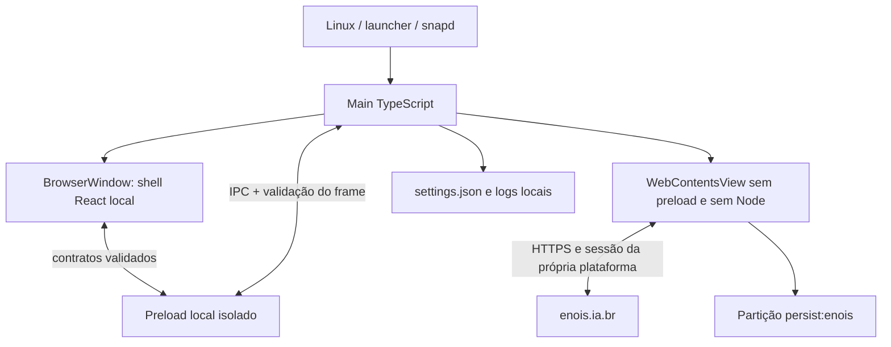

# Arquitetura

O main cria uma BrowserWindow com shell React local e um WebContentsView para o
site original. São conteúdos separados e fronteiras de confiança diferentes.
Não há backend local, modelo de negócio duplicado ou captura de credenciais.

## Inicialização e responsabilidades

1. `src/main/index.ts` registra o protocolo local seguro, habilita sandbox e obtém
   o lock de instância única. O perfil de produção não aceita URL de servidor via ambiente.
2. O perfil recebe permissão de diretório `0700`; preferências JSON são carregadas e
   validadas. Corrupção recupera os padrões, sem impedir abertura.
3. `windows/desktop-window.ts` cria janela e conteúdo remoto, configura lifecycle,
   menus, atalhos, estados e encerramento. Dimensões restauradas são limitadas à
   área útil do monitor existente. A referência do WebContents remoto é guardada
   na criação, permitindo verificar sua destruição no fechamento mesmo quando a
   view já não expõe a propriedade `webContents`.
4. `security/` aplica protocolo local, políticas de navegação e permissões. Recursos
   HTTPS de terceiros não recebem bloqueio indiscriminado; jogos e mídia mantêm a
   política web da plataforma, sem permissões nativas herdadas.
5. `ipc/register.ts` valida o WebContents emissor, frame principal, URL e argumentos.
   O preload existe apenas no shell; expõe estado, comandos enumerados, preferências
   e assinatura de atualização com função de limpeza.
6. React controla carregamento, erro, configurações e controles da janela. Os três
   comandos de janela são enumerados e aceitos somente do frame principal local.
   Maximizar/restaurar acompanha os eventos reais do sistema operacional. Quando o site
   está pronto, sua view ocupa a região abaixo da barra de 64 DIP.

## Navegação e recuperação

Somente a origem exata `https://enois.ia.br` pode ocupar o conteúdo principal.
Links HTTP/HTTPS externos ou e-mail têm destino no aplicativo padrão, com
confirmação inicial configurável. Protocolos perigosos e credenciais na URL são
bloqueados. Novas janelas da plataforma navegam na view existente; redirects
externos não são automaticamente tratados como um login autorizado.

Falhas HTTP, rede, timeout e renderer encerrado mostram feedback local com nova
tentativa manual. Não existe reconexão agressiva nem polling permanente. `resume`
atualiza o estado de conectividade, sem recarregar à força um formulário do usuário.

## Persistência

A partição `persist:enois` mantém cookies e dados web do próprio site. O cliente não
lê localStorage remoto, copia tokens ou armazena senhas. `settings.json`, separado
da sessão, guarda apenas opções implementadas e dimensões. As gravações são
serializadas e substituem o arquivo por rename; arquivos têm modo `0600`.

Logs JSON usam eventos e códigos limitados, níveis e métricas numéricas. URLs,
mensagens remotas, conteúdo de requests e credenciais não são registrados.

## Decisões

- [001: Electron, ferramentas e organização](decisions/001-foundation.md)
- [002: conteúdo remoto e IPC](decisions/002-remote-content.md)
- [003: sessão e dados locais](decisions/003-session.md)
- [004: Snap e atualizações](decisions/004-distribution.md)
- [005: controles da janela no Linux](decisions/005-window-controls.md)
- [Modelo de ameaças](security.md)
- [Compatibilidade da plataforma](../platform-compatibility.md)
